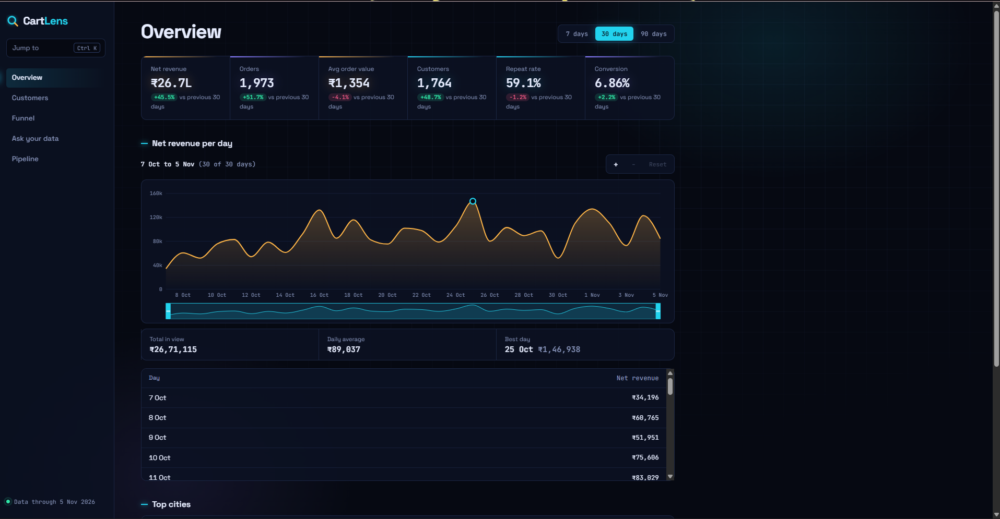
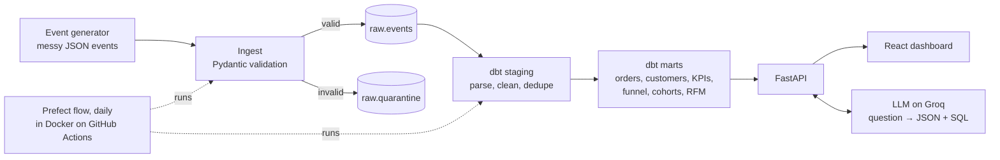

# CartLens: Customer Intelligence Platform

An end-to-end data platform for a (fictional) Indian D2C e-commerce store. Raw, messy tracking events are
loaded into Postgres every day, modelled with **dbt**, orchestrated with **Prefect**, served by **FastAPI**
and explored in a **React** dashboard. The highlight is **Ask your data**: type
*"Which city had the most repeat buyers last month?"* and get the answer as a chart, with the SQL that produced it.

The whole stack runs locally with one command: `docker compose up --build`.

**Live demo:** [   cartlens-bice.vercel.app](https://   cartlens-bice.vercel.app) · **API docs:** [cartlens-api.onrender.com/api/docs](https://cartlens-api.onrender.com/api/docs)


> The API runs on Render's free plan and sleeps after 15 minutes without traffic, so the first page load can take
> up to a minute. After that it is fast.



## What it does

| Page | What you see |
| --- | --- |
| Overview | Revenue, orders, AOV, customers, repeat rate and conversion, each compared with the previous period; a zoomable daily revenue chart; top cities |
| Customers | RFM segments (Champions, Loyal, At risk...) and a monthly cohort-retention grid |
| Funnel | Viewed → added to cart → checkout → ordered, with step conversion |
| Ask your data | Natural-language questions answered with SQL, a chart and a plain-English explanation |
| Pipeline | Row counts, AI model status, and the history of every pipeline run with its dbt test results |

**Exploring the revenue chart.** Zoom with the + / − buttons, Ctrl (⌘) + scroll, or the keyboard (← → to pan,
+ − to zoom, 0 to reset), or drag the navigator under the chart. The total, daily average, best day and the table
below always describe the window in view. **Ctrl + K** opens a quick switcher for the pages.

**Design.** A dark "control room" theme where each colour means one kind of number everywhere: amber is money,
cyan is people, violet is activity; green and pink only mean up and down. Motion (page entrances, KPI count-ups,
the funnel filling in) switches off when the operating system asks for reduced motion.

## Architecture



**Pipeline (daily, 07:00 IST).** A GitHub Actions cron builds the pipeline Docker image and runs the Prefect flow:

1. **Extract + load.** Work out which days are new since the last successful load (a first run backfills a year,
   missed days are caught up). Validate each event with Pydantic. Valid events are bulk-loaded with `COPY` and
   de-duplicated on `event_id`; invalid ones go to `raw.quarantine` with the reason.
2. **Transform + test.** `dbt build` rebuilds the seed, 3 staging views and 7 mart tables, and runs 37 data tests.
3. **Record.** Every run (success, up to date, or failed with the error) is written to `ops.pipeline_runs`,
   which the Pipeline page and `/api/health` read.

**The data is messy on purpose**, because cleaning is the job:

| Problem in the feed | Where it's handled |
| --- | --- |
| Timestamps in four formats (ISO+05:30, ISO UTC, `DD/MM/YYYY` local, epoch ms) | `parse_ts` dbt macro |
| Prices as numbers or strings like `"₹1,299.00"` | `parse_price` dbt macro |
| City spellings: Bangalore / BLR / Bengaluru, Bombay, Gurgaon... | `city_aliases` dbt seed + a test that fails on any unmapped spelling |
| Tracker retries: the same event delivered twice | `on conflict (event_id) do nothing` at load |
| Double-clicked "Pay": same order, new event id | `distinct on (order_id)` in `stg_orders` |
| Late events (delivered a day after they happened) and refunds days after the order | windowing by arrival date; models rebuilt in full each run |
| Malformed events (no customer, unknown type) | Pydantic validation → `raw.quarantine` |

The generator is deterministic (seeded by date), so any window can be regenerated exactly, and a test proves that
loading two adjacent windows equals loading the combined window.

## Ask your data: how it stays safe

LLM-written SQL never runs unchecked. There are three layers:

1. **Structured output.** The model (Groq, `openai/gpt-oss-120b`) must return JSON matching a strict schema:
   `{sql, chart: {type, x, y}, explanation}`. Pydantic validates it again on our side.
2. **SQL guard** (`app/sql_guard.py`, using sqlglot). Parses the SQL and allows exactly one `SELECT`, only the
   7 mart tables, no `SELECT INTO`, no row locks and no `pg_*` or other dangerous functions. The query that runs
   is re-rendered from the checked parse tree.
3. **Database.** Runs in a `READ ONLY` transaction with a statement timeout, a `search_path` of `analytics`,
   and a row cap.

If the SQL fails the guard or the database, the error is sent back to the model for **one** repair attempt.
The prompt's schema comes from Postgres column comments that dbt writes from the model YAML (`persist_docs`), so
the documentation and the AI's view of the data cannot drift apart. Relative dates ("last month") are anchored to
the latest date in the data, not the server clock.

Without a `GROQ_API_KEY` the app runs in a clearly labelled **demo mode** that answers the five example
questions with pre-written SQL (still checked by the guard and run on live data).

## Tech stack

| Layer | Tools |
| --- | --- |
| Data | PostgreSQL 17 (Neon in production), dbt-core 1.12 + dbt-postgres |
| Orchestration | Prefect 3, scheduled by GitHub Actions |
| API | Python 3.11, FastAPI, psycopg 3 + connection pool, sqlglot, httpx |
| AI | Groq `openai/gpt-oss-120b` with JSON-schema structured outputs |
| Frontend | React 19, React Router 8, Recharts 3, Vite 8; plain CSS with design tokens |
| Testing | pytest + pytest-cov, Vitest 5 + Testing Library, dbt data tests |
| Infra | Docker + Docker Compose, GitHub Actions, Render (API, Docker runtime), Vercel (frontend) |

## Run it locally

You need Docker Desktop.

```bash
docker compose up --build
```

The pipeline container loads a year of events (about 530,000) and runs `dbt build` (about a minute), then the API
starts on http://localhost:8000 (docs at `/api/docs`) and the dashboard on http://localhost:8080.

To use a real LLM, copy `.env.example` to `.env`, add a free key from console.groq.com, and run the command again.

### Developing without the containers

```bash
docker compose up -d db                 # just Postgres

cd backend
python -m venv .venv && .venv\Scripts\activate      # Windows; on macOS/Linux: source .venv/bin/activate
pip install -r requirements-dev.txt
python -m pipeline.flow                 # load data + dbt build
uvicorn app.main:app --reload --env-file ../.env

cd ../frontend
npm ci
npm run dev                             # http://localhost:5173
```

## Tests

| Suite | Count | Coverage |
| --- | --- | --- |
| Backend unit (pytest) | 106 | |
| Backend integration (real Postgres, Prefect flow, dbt build) | 29 | 98.6% combined (gate: 90%) |
| Frontend unit + integration (Vitest) | 67 | 98.6% statements, 97.9% branches, 96.6% functions, 98.9% lines (gate: 90%) |
| dbt data tests (every pipeline run) | 37 | |

```bash
cd backend && pytest --cov          # needs: docker compose up -d db
cd frontend && npm run coverage
```

CI runs lint, all tests with the coverage gates, a production build, `npm audit` and a build of all three Docker
images on every push. See [docs/TESTING.md](docs/TESTING.md) for the strategy.

## Design decisions

- **Prefect, not Airflow.** Airflow needs a scheduler, webserver and metadata database running all the time,
  which doesn't fit free hosting. Prefect flows are plain Python functions, easy to unit-test, and run anywhere,
  including a short-lived GitHub Actions container.
- **ELT with dbt.** Raw events are stored exactly as received (JSONB), and all cleaning is versioned SQL with
  tests. If a cleaning rule changes, history is rebuilt from raw.
- **Full rebuilds, not incremental models.** At ~1,500 events a day a full `dbt build` takes seconds and is
  always correct with late-arriving data. Incremental models are the upgrade path at higher volume.
- **Synthetic data.** No licence issues, realistic for India (cities, rupees, festive-season spike), fully
  reproducible, and dirty in known ways so every cleaning step can be tested.
- **Neon for production Postgres.** A permanent free tier (Render's free Postgres expires).

## Deployment

| Part | Where | Notes |
| --- | --- | --- |
| Database | Neon (free, AWS Singapore) | `DATABASE_URL` uses the direct (non-pooled) connection string |
| Pipeline | GitHub Actions + Docker | `.github/workflows/pipeline.yml`, needs the `DATABASE_URL` repository secret |
| API | Render (Docker, free, Singapore) | `render.yaml`; set `DATABASE_URL`, `CORS_ORIGINS`, `GROQ_API_KEY`. Free instances sleep after 15 minutes idle, so the first request can take ~1 minute |
| Frontend | Vercel | Root directory `frontend`, install command `npm ci`, env var `VITE_API_URL` |

The API and database are in the same region (Singapore), so each query is a short hop rather than a round trip
across the Pacific.

GitHub pauses scheduled workflows after 60 days without repository activity; re-enable it from the Actions tab.

## Roadmap

- Churn-risk model (probability that a customer won't order again in 90 days) as a new mart
- Incremental dbt models and a streaming ingest path (Redpanda) for higher volumes
- A separate read-only database role for Ask your data, in addition to read-only transactions
- Host the dbt docs site; Playwright end-to-end tests (including chart zoom and drag, which jsdom cannot lay out)
- Split the Recharts bundle with dynamic `import()` so the first page loads less JavaScript

## License

MIT © 2026 Astitva Sharma
